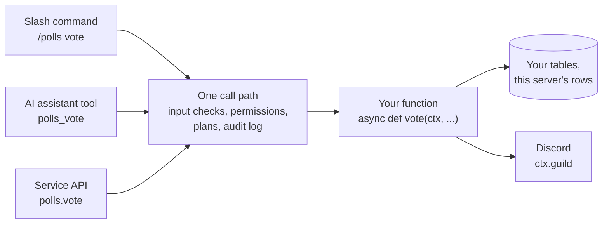

# Reference

Every part of a plugin, in one page. The table of contents on the right is its index. [Your first plugin](index.md) and the [tutorial](tutorial.md) show the same parts in use.

This covers `teabot.sdk` 1.x, which follows semantic versioning: a change that breaks plugins needs a new major version. Parts added after 1.0 say which release added them; a plugin that uses one depends on that release or later, as `teabot new-plugin` writes.

## How a plugin is reached



- One decorated function is a slash command, a tool for AI assistants, and an action in teabot's service API.
- Every call takes the same path. teabot checks the input against your function's parameters, checks the member's Discord permissions, shows a plan first for a destructive action, and records the call in the audit log. Only then does your function run.
- Your function works in one server at a time: `ctx.guild`, and the rows of that server in your own tables.

Worked examples, which import only `teabot.sdk` like yours: [giveaways](https://github.com/teabot-dev/teabot-giveaways/blob/main/src/teabot_giveaways/__init__.py) from the plugin hub (jobs, settings, a plan, posting with a transaction), and [announcements](https://github.com/teabot-dev/teabot/blob/main/src/teabot/plugins/announcements/__init__.py) and [roles](https://github.com/teabot-dev/teabot/blob/main/src/teabot/plugins/roles/__init__.py), which ship with teabot.

## The package

- A plugin imports only `teabot.sdk`, and its tests only `teabot.sdk` and `teabot.testing`. Everything else in `teabot` is internal and may change in any release. `teabot check` and the test harness both refuse other imports.
- `pyproject.toml` declares an entry point in the `teabot.plugins` group, pointing at the plugin object. Its name must be the plugin's id:

    ```toml
    [project.entry-points."teabot.plugins"]
    raffles = "teabot_raffles:plugin"
    ```

- A plugin outside this repository depends on a compatible range of teabot, such as `teabot>=1.1,<2`.
- Ship a `py.typed` marker, and a `README.md` with an "External connections" section listing every host the plugin contacts, or "none".

## The plugin object

```python
from teabot.sdk import Context, Plugin

plugin = Plugin("raffles", config=RafflesConfig, description="Raffles that members enter with a button.")
type Ctx = Context[RafflesConfig]
```

- `Plugin(id, *, config=EmptyConfig, migrations=None, hosts=(), description="")`. The version comes from the installed package, and migrations from `migrations/` beside the module that made the plugin, unless `migrations` names another directory.
- `description` is one sentence on what the plugin does. A teabot's site shows it in its plugin browser. Added in 1.8.
- `reads=["members"]` opens [the member directory](#the-member-directory), and `writes=["labels"]` opens [member labels](#member-labels), with `labels_fresh_for`, how long they count. The site shows both on the plugin's page.
- The id matches `[a-z][a-z0-9_]{1,31}`. `core`, `admin`, `teabot`, `plugin`, `plugins`, `audit` and `tokens` are reserved. Two installed packages with the same id both fail to load.
- When the plugin loads, teabot imports every module of its package, so decorated functions in any module register themselves. It skips `tests`, modules whose names start with `_`, and `__main__`.
- Anything that fails while the plugin loads fails that plugin alone, which keeps none of its registrations. Everything else still loads.
- To run code at load, subclass `Plugin` and override `setup(registrar)`, calling `super().setup(registrar)`.

## Actions

```python
@plugin.action(risk=WRITE, needs="manage_guild")
async def draw(ctx: Ctx, channel: TextChannel, prize: Annotated[str, Field(max_length=100)]) -> Drawn:
    """Draw a raffle winner.

    Args:
        channel: Where to announce the winner
        prize: What the winner gets
    """
```

- `@plugin.action(*, risk=WRITE, needs=(), name=None, reply="private")`.
- The function's name is the action's name, so this is the slash command `/raffles draw`, the MCP tool `raffles_draw` and the service action `raffles.draw`. `name=` overrides it, and a trailing underscore is dropped, so `list_` is `list`.
- `risk` is `READ` (no side effects), `WRITE` (easy to undo) or `DESTRUCTIVE` (bulk or hard to undo). A destructive action needs a plan and always runs in two steps.
- `needs` is a Discord permission, or a tuple of them, by discord.py's name, such as `"manage_messages"`. The core checks it live on every call, and pyright checks the names.
- `reply="public"` shows the reply to the channel. Replies are private by default.
- The docstring's first line is the summary. Its `Args:` section describes every input, each in at most 100 characters. A missing entry fails the load and names the line.

- A call that takes longer than a minute is stopped, and the member is told `That took too long, so it was stopped.` An action that needs longer says so, as in `@plugin.action(timeout=timedelta(minutes=5))`. A destructive action's apply runs as a job, with up to an hour.

### Inputs

Every parameter after the context is an input. Each may be optional (`X | None = None`) or have a default.

| Type | In Discord |
|---|---|
| `str`, `int`, `bool` | a text, number or true/false option |
| `Literal["a", "b"]`, or a `Literal` of ints | a choice |
| `LongText` | multi-line text, typed in a modal |
| `TextChannel`, `Role`, `Member` | a picker; the function receives the channel, role or member itself |
| `VoiceChannel` | a picker of voice channels only; the function receives the channel (1.4) |
| `ChannelRef`, `VoiceChannelRef`, `RoleRef`, `MemberRef` | a picker; the function receives the Discord ID |
| `list[X]` of any of these but `LongText`, with `Field(max_length=...)` up to 10, or up to 25 for an action whose `surfaces` leave out `Surface.SLASH` | numbered options, such as `roles_1` to `roles_5`; MCP clients send an array |
| a pydantic model of these types, such as `MemberFilter` | each of its fields an input of its own; the function receives the model (1.11) |

- Limits go in `Annotated[int, Field(ge=1, le=20)]` or `Annotated[str, Field(max_length=100)]`. Discord enforces them before the member sends.
- A `TextChannel` that is missing or takes no messages, or a `Role` or `Member` not in the server, is refused with a message the member sees, and the function does not run.
- A list needs its `max_length`, and its `min_length` says how many of its options are required: `Annotated[list[Role], Field(min_length=1, max_length=5)]`. Lists were added in 1.3.
- Take a Discord ID as `Role`, `TextChannel`, `Member` or a `*Ref`, never as an `int`: Discord's number options stop at 2^53, and IDs are larger.
- An ID can be typed as the ID or as a mention, such as `<#123>`, which is what Discord inserts when someone types `#` or `@` in a text option or a setting.
- A model's fields take their descriptions from the model, so leave the model's parameter out of `Args:`. A field named like another input, or `confirm`, fails the load. A model with many fields suits an action offered to AI assistants and the service API, `surfaces=Surface.MCP | Surface.SERVICE`, since a slash command holds at most 25 options.
- Any other type fails the load.

### Suggestions

Added in 1.3.

```python
@enter.autocomplete("giveaway")
async def running(ctx: Ctx, typed: str) -> list[Choice[int]]:
    rows = await ctx.db.fetch(Running, RUNNING, ctx.guild.id)
    return [Choice(f"{r.id}: {r.prize}", r.id) for r in rows if typed in r.prize]
```

- `@action.autocomplete("option")` suggests values for a `str` or `int` option, or a list of them, as the member types: up to 25 `Choice(name, value)`s, from what has been typed so far. A list's numbered options share it.
- `ctx.filled` holds the options the member filled in before this one, by input name, as Discord sent them, so a suggester can depend on them, such as listing the options of the poll already chosen. Discord sends only those filled in so far, so check that the one you need is there. Added in 1.14.
- Suggest an ID as a `str` value, such as `Choice(member.display_name, str(member.id))`, for the reason above. For channels, roles and members, Discord's own pickers already suggest, so an option of those types needs no suggester.
- It runs as the member, without the audit log, and must answer within Discord's three seconds. When the action would be refused, or the function fails or is slow, the member sees no suggestions.
- One function can suggest for several actions: stack the decorators.

### Outputs

- An action returns a Pydantic model, a list of models, or a `str`.
- In Discord a model is shown through its `render()` method if it has one, and otherwise as an embed of its fields. A list is shown one line per item, and a string as written.
- Without a `render()`, values show by their type: a `datetime` as a Discord timestamp, in each viewer's own time zone; a `ChannelRef`, `RoleRef` or `MemberRef` as a mention; `True` and `False` as yes and no. Added in 1.4.
- Mark text that members wrote as `UntrustedText`, which MCP clients receive wrapped as data.
- To tell the member what went wrong, raise `ActionError("That raffle has ended.")`. The message is shown as written and recorded in the audit log. Any other exception shows a generic reply and keeps its details in the audit log.

### Plans

```python
@cancel.plan
async def plan_cancel(ctx: Ctx, raffle: int) -> Diff:
    entries = await ctx.db.fetch(Entry, ENTRIES, ctx.guild.id, raffle)
    return Diff(entries=[DiffEntry(change="remove", target=e.name, key=e.id) for e in entries])
```

- A destructive action's plan takes the same inputs and returns a `Diff` of what it would change. Without a plan the load fails.
- The member sees the plan and confirms it within 15 minutes. If what it shows has changed by then, they get a fresh plan, marked stale, instead.
- The action then runs as a job and reads the confirmed plan as `ctx.diff`. An entry's `key` carries what the apply needs, such as a row id, so it changes exactly what the member saw.
- `Diff(notes=[...])` adds lines above the entries, such as counts, an estimate or the change in a sentence. Notes are never hashed, so only the entries decide whether a plan is stale. Added in 1.11.
- A destructive action returns a model, a list or a string like any other, but the member does not see it: they see the plan, then a reply that follows the change as it applies, ending with `Done.` Report how far it has got with `await ctx.report({"done": 3, "total": 10})`, which that reply shows as `3 of 10`, and `/admin job_status` too. Other keys show as they are, such as `{"cleared": 3}` as `cleared 3`.

## The context

`ctx` is for one server:

- `ctx.guild`: the server, as a `Guild`. `get_text_channel(id)`, `get_channel(id)`, `get_role(id)` and `await get_member(id)` find things in it, or return `None`. [Working with the server](#working-with-the-server) lists what else it does.
- `ctx.actor`: who asked. `user_id` is the member, `via` how the call came in (`"slash"`, `"component"` for a button, a select menu or a confirmation, `"menu"` for a right-click menu, `"mcp"`, `"service"`, `"job"`, or `"event"`), and `token_id` the token for MCP and service calls. In a job, it is the member who scheduled it; in an event, and a job nobody scheduled, it is `SYSTEM`.
- `ctx.config`: the plugin's config for this server, as the plugin's own model.
- `ctx.db`: the plugin's database, as its own role in its own schema.
- `ctx.now`: the time. Read the clock only through it, since tests move it.
- `ctx.diff`: in a destructive action's apply, the confirmed plan, and an empty `Diff` everywhere else.
- `ctx.filled`: in a suggester, the options the member filled in so far, and empty everywhere else. [Suggestions](#suggestions) says how.
- `await ctx.report(progress)`: progress for `/admin job_status`.
- `ctx.voice`: the server's voice connection, which the plugin joins, plays through and leaves. [Voice](#voice) says how.
- `ctx.members`: the server's member directory, for a plugin that declares it. [The member directory](#the-member-directory) says how.
- `ctx.labels`: the plugin's labels about the server's members, for a plugin that declares them. [Member labels](#member-labels) says how.
- `ctx.audit_id`, `ctx.authorized`, `ctx.record_outcome` and `ctx.log`: for work that outlasts its apply. [Work that outlasts its apply](#work-that-outlasts-its-apply) says how.

To post, send to a `TextChannel`:

```python
await channel.send("**A pet** goes to <@123>.", ping=[123])
await channel.send(embed=discord.Embed(title="Results"))
```

- Messages mention nobody unless you name members with `ping=`.
- A channel the bot may not post in raises an `ActionError` that says so.
- `files=[File("results.csv", data)]` attaches files.
- A post that goes with database writes, such as a draw's winners, goes through the transaction instead, with `tx.send`. See [Posting with a transaction](#posting-with-a-transaction).

## Right-click menus

```python
@plugin.action(menu="Give a pet", needs="manage_roles")
async def give_pet(ctx: Ctx, member: Member) -> str:
    """Give a member a pet.

    Args:
        member: Who gets it.
    """
    ...


@plugin.action(menu="Report")
async def report(ctx: Ctx, message: ReceivedMessage) -> str:
    """Report a message to the moderators.

    Args:
        message: The message.
    """
    ...
```

- `menu=` adds the action to Discord's **Apps** menu, under the name given, up to 32 characters: on a member when its one input is a `Member`, and on a message when it is a `ReceivedMessage`.
- The target fills that input. A message arrives with its text, whatever the Message Content intent.
- An action on a member stays a slash command and a tool too. An action on a message is not a slash command, since no slash command can give one.
- It runs as the member who chose it, with `ctx.actor.via` `"menu"`, through the same permission and audit checks as a command.
- Discord shows five menu commands of each kind in a server. Past five, the first five by action name are kept.
- In tests, `await harness.menu(give_pet, member)` and `await harness.menu(report, message)` choose them.

## Reaching the web

```python
plugin = Plugin("wom", hosts=["api.wiseoldman.net"])


@plugin.action()
async def rank(ctx: Ctx, name: str) -> str:
    found = await ctx.http.get(f"https://api.wiseoldman.net/v2/players/{name}")
    return found.json()["type"] if found.ok else "Not found."
```

- `ctx.http.get(url, params=...)` and `ctx.http.post(url, json=...)` reach the hosts in `Plugin(..., hosts=[...])`, by their exact names, and nothing else. Another host raises `HostNotDeclared`.
- They return a `Response`: `status`, `ok`, `headers`, `text` and `json()`. A request waits 10 seconds, or `wait=` seconds.
- Redirects are not followed, so a reply cannot send a request to a host the plugin did not declare.
- List the same hosts in the README's "External connections". `teabot check` refuses an HTTP library of the plugin's own, such as `requests`, `httpx` or `aiohttp`.
- One exception: a plugin that streams media, such as music, may reach its media hosts through its media library, such as yt-dlp, outside `ctx.http`. Its README's "External connections" lists those hosts and the library that contacts them, and the hub reviews the library too. Everything else still goes through `ctx.http`.
- In tests, `harness.web.reply(url, json_body=...)` sets what a URL answers, and `harness.web.requests` holds what was sent. A URL without a reply fails the test.

## Working with the server

Added in 1.3, except finding channels, roles and members, and sending.

Every operation acts with the bot's own power, so **the plugin decides who may use it**: through the action's `needs=`, and its own checks where it lets members do something they could not do in Discord themselves, as the [roles plugin](https://github.com/teabot-dev/teabot/blob/main/src/teabot/plugins/roles/__init__.py) does. Before calling Discord, each operation refuses what Discord would, with an `ActionError` the member can read, such as "Raids is at or above my highest role".

| On | Read | Do |
|---|---|---|
| `Member` | `name`, `display_name`, `roles` (highest first), `top_role`, `role_ids`, `joined_at`, `avatar_url`, `bot`, `timed_out_until` | `add_role(role, by=)`, `remove_role(role, by=)`, `set_nickname`, `timeout(timedelta)` up to 28 days, `remove_timeout`, `kick`, `send` a direct message |
| `Role` | `name`, `position`, `permissions` (as `needs=` names them), `colour`, `managed`, `mentionable`, `hoisted` | |
| `Guild` | `name`, `icon_url`, `owner_id`, `member_count`, `me` (the bot), `roles`, `channels` (any kind, each with its `kind`, `parent_id` and `nsfw`), `can_assign(role, by=, give=)` | `find_members(prefix)`, `add_role(user_id, role, by=)` and `remove_role(...)` by member ID, `ban(user_id, delete_message_days=)`, `unban`, `bans()` |
| `Message` the bot sent | `id`, `channel_id`, `jump_url` | `edit`, which replaces its text, embed, buttons and files; `delete` |
| `TextChannel` | `name`, `mention`, `read_message(id)` for anyone's message, `reactors(message_id, emoji)` for who reacted | `send`, `get_message(id)` for one of the bot's own posts |

- Every change takes `reason=`, which Discord's audit log shows. Without one, it says which action asked and for whom.
- The bot cannot manage a role at or above its own highest role, a managed role, or a member who outranks it, and it cannot kick, ban or rename the server's owner.
- **Acting for a member, `by=`.** A role given or taken `by=member` is refused, unless they own the server, when they lack Manage Roles, when the role sits at or above their highest role, or, for giving, when it grants a permission they lack. So the bot never gives a role the member could not give themselves, and Discord's audit log names them: "via teabot: roles.give, for member 123", with a `reason=` after it. `ctx.guild.can_assign(role, by=member)` runs the same checks without changing anything, for a plan, and returns why not, or `None`. Discord never compares the target member's rank for a role change. Added in 1.11.
- **By member ID.** `ctx.guild.add_role(user_id, role, by=)` changes a member teabot has not seen in one request, without fetching them, and raises `MemberGone` when they have left. Added in 1.11.
- `DANGEROUS` names the permissions that act on others or the server, such as Administrator, Ban Members and Manage Roles, for a plugin that refuses roles granting them.
- `get_channel` and `get_text_channel` find threads too, so a reaction or message in a thread leads to its channel. A thread is `nsfw` when the channel it is in is.
- `read_message(id)` returns any message in the channel as a `ReceivedMessage`, or None when it is gone. `reactors(message_id, emoji)` returns the IDs of the people who reacted with `emoji`, bots left out, oldest first: count from it, and a reaction given while teabot was down still counts. Both added in 1.7.

## The member directory

Added in 1.11. teabot keeps a directory of every server's members (D55), and a plugin that declares it reads it as `ctx.members`:

```python
plugin = Plugin("ranks", reads=["members"])


@plugin.action(risk=READ)
async def count_rank(ctx: Ctx, role: Role) -> str:
    """How many people have a rank.

    Args:
        role: The rank
    """
    return f"{await ctx.members.count(PeopleFilter(roles_any=[role.id])):,} people"
```

- `await ctx.members.count(filter)` counts present members a `MemberFilter` matches. `await ctx.members.find(filter, after=0, limit=1000)` returns them as `DirectoryMember`s, in user ID order: pass the last one's `user_id` as `after` for the next page.
- Both take several filters, `count(f1, f2)`, which a member must all match, such as a filter an admin gave and one the plugin adds. Added in 1.12.
- `MemberFilter` is the filter `admin_members` takes: roles any, all or none, no roles, joined and account-created days, join method, invite and inviter, boosting, timed out, pending, bots, and a plugin's [labels](#member-labels). `PeopleFilter` matches people only unless told otherwise. An action can take one as an input, and an assistant then previews it with `admin_members` before calling.
- Before a server's directory has its first copy, or where the operator turned it off, both raise `DirectoryUnavailable`, an `ActionError` that says why.
- Without `reads=["members"]`, `ctx.members` raises `NotDeclared`. The site shows the declaration on the plugin's page, and the guide's [review checklist](#review-checklist) asks for it. It is a declaration, not a sandbox: plugin code runs in teabot's process.
- Names are member-written text (D23), and `find` answers only for this server.

### Member labels

Added in 1.12. A plugin that knows something about members which Discord doesn't, such as which game account each one linked, keeps it as labels: short strings, such as `in_clan` or `rank:sapphire`. Filters match them, so `admin_members`, other plugins and role changes can act on them.

```python
plugin = Plugin("clan", reads=["members"], writes=["labels"])


@plugin.job(every=timedelta(hours=1))
async def sync(ctx: Ctx) -> None:
    fetched = await fetch_roster(ctx)
    await ctx.labels.replace_all({m.user_id: m.labels for m in fetched.members}, as_of=fetched.at)
```

- `await ctx.labels.replace_all(labels, as_of=...)` replaces every label the plugin keeps in the server, member ID to labels, in one transaction. A member left out loses theirs. It returns how many members' labels changed.
- `as_of` is how fresh the data behind them is, such as the last successful fetch. Pass the time of the data, not the time of the write, so a write after a failed fetch never makes old data look current.
- A filter matches them with `MemberFilter(labels_from="clan", labels_any=["in_clan"])`, or `labels_all`. `labels_from` alone matches anyone with a label from that plugin.
- They count only while the plugin is enabled in the server and `as_of` is within `labels_fresh_for`, a day unless the plugin declares otherwise, up to a week. Otherwise a filter on them matches nobody, so a plugin that stops syncing stops counting.
- A member has at most 32 labels from one plugin, each up to 64 characters with no spaces; `LabelError` says what is wrong. Writing waits for the server's directory, as `ctx.members` does, with `DirectoryUnavailable`.
- `@plugin.on_labels_changed` runs with the ID of the plugin whose labels changed: when its `replace_all` changes anyone's, when its labels become fresh again, and when it is turned back on. Any plugin enabled in the server hears it.
- Labels are deleted with a member's data. Any plugin that reads the directory can filter on them, so they say nothing a server's plugins shouldn't know.
- Without `writes=["labels"]`, `ctx.labels` raises `NotDeclared`.

## Buttons and select menus

Added in 1.3.

```python
await channel.send(
    "**Pick your pings**",
    buttons=[Button(toggle.bind(role=raids), label="Raids", emoji="🗡️", style="primary")],
)
```

- `action.bind(...)` fixes an action's arguments, checked by pyright against its function. A `Role`, `TextChannel` or `Member` is kept as its ID.
- `action.asking(...)` fixes some and leaves required text inputs out, up to five: pressing the button opens a form for them, and the action runs with what the member types. A "Link accounts" button that asks for names is one. In tests, `harness.press(button, typed={"names": "..."})` fills the form. Added in 1.12.
- A `Button` runs the bound action as the member who presses it, through the same path as a slash command: `needs=` is checked against the presser, the call is audited, and a destructive action shows its plan.
- The call is held in the button itself, so a button keeps working after a restart, and needs nothing stored. It must fit Discord's 100 characters: bind IDs, never long text.
- A post holds up to 25 buttons, five to a row. `style` is `"primary"`, `"secondary"` (the default), `"success"` or `"danger"`.
- `Select(action.bind(...), into="roles", ...)` is a select menu: of `Option`s, filling a `list[str]` parameter, or with `kind="role"`, `"channel"` or `"member"`, Discord's own pickers, filling a list of those. The parameter it fills needs a default, such as `= None`, since `bind` leaves it out. A post holds one menu and up to 20 buttons. A picker opens with `defaults=(id, ...)` chosen, such as the roles the member has; a menu of options ticks `Option(..., default=True)` instead.
- A press's reply is private unless the action says `reply="public"`.
- An action only its buttons and menus should reach takes `@plugin.action(surfaces=Surface.COMPONENT)`: it is then no slash command and no MCP tool. The roles plugin's `toggle` is one.
- Discord's own role, channel and member pickers cannot be limited to some roles. To offer a chosen few, use a menu of `Option`s whose values are the IDs, as strings.
- A menu's options are fixed when it is posted, and a post can outlive the roles or settings it was made from, so the action checks the choices again when it runs.

## Events

Joins and leaves were added in 1.3, and the others in 1.4.

```python
@plugin.on_member_join
async def welcome(ctx: Ctx, member: Member) -> None:
    await member.send(f"Welcome to {ctx.guild.name}!")


@plugin.on_member_leave
async def farewell(ctx: Ctx, user: User) -> None:
    await channel.send(f"{user.name} has left.")
```

- They run in the servers where the plugin is enabled, as the bot: `ctx.actor` is `SYSTEM`, with `via` `"event"`.
- Each runs as one of the plugin's jobs, `on_member_join` or `on_member_leave`, so a failure is retried, up to three attempts, and shows in `/admin job_status`. A member who has left again by the time a join runs is skipped.
- A leave gets a `User`, with the `id` and the `name` they had, since they are no longer a member to look up.

### Changes found late

When teabot restarts, or misses events, it compares its member directory with Discord's member list and finds what changed meanwhile, such as joins during a deploy. A handler hears those only when it asks, with `late=True`, and then takes a third argument, `since`: when the gap began, or `None` for a change heard as it happened. Added in 1.10.

```python
@plugin.on_member_join(late=True)
async def give_role(ctx: Ctx, member: Member, since: datetime | None) -> None:
    await member.add_role(ctx.config.role_id)
```

- `on_member_join`, `on_member_leave` and `on_member_roles` take `late=True`.
- An auto-role plugin wants late joins, so nobody who joined during a restart is left without the role. A welcome plugin does not, so nobody is greeted hours after joining.
- In tests, `harness.join(member, since=...)`, `harness.leave(member, since=...)` and `harness.change_roles(member, added=..., since=...)` fire a late change.

The other events work the same way:

```python
@plugin.on_message
async def count(ctx: Ctx, message: ReceivedMessage) -> None:
    await ctx.db.execute(COUNT, ctx.guild.id, message.author_id)


@plugin.on_reaction_add
async def starred(ctx: Ctx, reaction: Reaction) -> None:
    if reaction.emoji == "⭐":
        await ctx.db.execute(STAR, ctx.guild.id, reaction.message_id)
```

| Decorator | The handler receives | When |
|---|---|---|
| `@plugin.on_message` | `ReceivedMessage`: `id`, `channel_id`, `author_id`, `content`, `attachments`, `created_at`, `jump_url` | A person posts in a server. |
| `@plugin.on_reaction_add` | `Reaction`: `message_id`, `channel_id`, `user_id`, `emoji` | A person reacts to any message. |
| `@plugin.on_reaction_remove` | `Reaction` | A person takes a reaction off. |
| `@plugin.on_member_roles` | `RoleChange`: `member`, and the role IDs `added` and `removed` | A member's roles change. |
| `@plugin.on_voice` | `VoiceChange`: `member`, and the channel IDs `left` and `joined` | A member joins, leaves or moves between voice channels. |
| `@plugin.on_enable` | nothing but `ctx` | The server turns the plugin on, each time. Check what is already there first. |

- Messages and reactions from bots, teabot's own among them, are not heard, so plugins cannot set each other off in a loop.
- A message's `content` and `attachments` are empty unless the operator turns on the Message Content intent, with `TEABOT_MESSAGE_CONTENT=true` (see [Settings](../host/settings.md)). Messages that mention the bot carry them anyway. Say in the plugin's README when it needs the intent.
- Each `Attachment` has its `filename`, `url` and `content_type`, and `image` says whether an embed can show it. Added in 1.7, with `created_at`, when the message was posted.
- Every message in a busy server queues one job for each listening plugin, so keep the handler quick, such as one statement.
- A role change is heard for every member, from teabot's [member directory](../use/members.md). While a server's directory is still taking its first copy, or is off above the operator's member limit, only changes for members teabot has seen since it started are heard. A server with a levelling or reaction-role bot changes roles often, so a plugin with `on_member_roles` gets a job for each change.
- `emoji` is the character, such as `"⭐"`, or a server emoji as `"<:raids:123>"`, as a `Button`'s `emoji` takes it.

## Plugin events

A plugin announces what happened as an event, and other plugins react to it, with no import between them. Programs outside teabot read the same events through the [events feed](../use/ai.md#follow-a-servers-events). Added in 1.14.

```python
class Accepted(BaseModel):
    ticket: int
    title: UntrustedText
    claimant: MemberRef

plugin = Plugin("tickets", emits=[Event("accepted", Accepted, "A claim on a ticket was accepted")])

async with ctx.db.transaction() as tx:
    await tx.execute(LOCK_TICKET, ctx.guild.id, ticket)
    ...
    await tx.emit(Accepted(ticket=ticket, title=title, claimant=claimant))
```

```python
@plugin.on_event("tickets.accepted", Accepted)  # this plugin's own copy of the model
async def accepted(ctx: Ctx, event: Received[Accepted]) -> None:
    if await already_applied(ctx, event.data.ticket, event.id):
        return
    ...
```

**Emitting:**
- `Plugin(emits=[...])` declares each event: a name, a payload model, and a line saying what it means. Its full name is `<plugin>.<name>`, such as `tickets.accepted`. Each event has a model of its own.
- A payload holds strings, numbers, booleans, dates, lists of these and models of these. A member's ID is a `MemberRef`, so deleting that member's data deletes the events naming them; a plain `int` would escape it. Member-written text is `UntrustedText`.
- `tx.emit(payload)` emits inside the transaction, so the event exists exactly when the change commits, and returns its ID. It refuses a model the plugin doesn't declare, more than 100 events in one transaction, and a payload over 8 KB of JSON.
- Lock the row of the thing the event is about before emitting, such as the ticket. Then for one thing a later event always has a higher `id`.
- teabot records who caused it, from the action or job: `event.by`. A payload has no actor field of its own.

**Subscribing:**
- `@plugin.on_event("<plugin>.<event>", Model)` runs the handler in each server where the plugin is enabled, as a job of its own, `on_event:<name>`. It gets a `Received` with `id`, `source`, `name`, `at`, `by` and `data`, validated into the model.
- Delivery is at least once. A retry can deliver one event twice, and a retried job can run after a later event's. So check `event.id` before changing anything, and keep the last `id` applied for each thing, dropping an older one.
- A handler hears what already happened, and can't undo or delay it. It runs as the system, so it changes what the plugin may change on its own: its tables, labels and posts. To change roles, write labels for role rules.
- A plugin can't read another plugin's tables, so act on the payload alone.
- A failing handler is retried over about two hours, 13 attempts. If the last fails, the server's log channel says which event was lost.
- When teabot starts, it logs a warning for a subscription to an event no loaded plugin declares, and for a field the subscriber's model needs that the emitter's payload lacks.

**As public API:** an event's name and payload are a promise to its subscribers. The plugin's snapshot records each one. Adding a field is compatible, since a subscriber's model ignores fields it doesn't know; never set `extra="forbid"` on one. Removing or retyping a field, making it optional, or renaming an event breaks subscribers, so say so in the changelog. List each event on the plugin's docs page, with the thing it is about.

Events are kept for 30 days.

## Work that outlasts its apply

Added in 1.11. A destructive change to thousands of members can take hours, past an apply's time limit. The apply then stores the work, hands it to a job of the plugin's, and returns `HandedOff`:

```python
@plugin.action(risk=DESTRUCTIVE, needs="manage_roles")
async def give_matching(ctx: Ctx, role: Role, filter: PeopleFilter) -> HandedOff:
    async with ctx.db.transaction() as tx:
        change = await tx.fetchval(int, NEW_CHANGE, ctx.guild.id, role.id, ctx.audit_id)
        await tx.schedule(run_change.bind())
    return HandedOff(id=str(change), text=f"Change {change} is under way.")
```

- `ctx.audit_id` is the apply's row in the audit log, which records who confirmed the work, through which door and with which token. Keep it with the work as its grant.
- In each run of the job, `actor = await ctx.authorized(grant)` checks the grant as teabot checks a call: the plugin is still on, the member still has the action's permissions, and a token is still valid. It returns the member's `Actor`, or raises `NotAuthorized` with why, so the job stops the work rather than carrying on for someone who may no longer do it.
- `await ctx.record_outcome(grant, text, failed=False)` closes the work once, in the audit log, which posts it to the server's log channel. The apply's own row says "handed off".
- `await ctx.log(grant, text, failed=False)` adds a line under the grant to the audit log, as often as needed, for work that goes on, such as a rule that runs each day. It leaves the grant open.
- Work in short bursts, and have each run queue the next before it starts, so a restart resumes it. The roles plugin's `changes` module is a complete example.

## Voice

Added in 1.8. A plugin plays audio in a voice channel through `ctx.voice`. It needs teabot's voice extra: depend
on `teabot[voice]`.

```python
@plugin.action()
async def play(ctx: Ctx, channel: VoiceChannel) -> str:
    """Play the anthem.

    Args:
        channel: Where to play it.
    """
    await ctx.voice.join(channel)
    await ctx.voice.play(anthem_packets(), track="anthem")
    return "Playing."


@plugin.on_track_end
async def ended(ctx: Ctx, track: str, error: str | None) -> None:
    await ctx.voice.leave()


@plugin.on_voice_resume
async def resumed(ctx: Ctx, channel: VoiceChannel | None) -> None:
    await ctx.voice.leave()
```

- A bot has one voice connection per server. The plugin that joins holds it until it leaves, and another
  plugin's `join` is refused while it does. `ctx.voice.state` says where the bot is, which plugin holds the
  connection and what plays, or is `None`.
- `join(channel)` joins a voice channel, or moves there. It refuses, with a reason the member sees, a channel the
  bot may not connect or speak in. Stages are not voice channels: on one, the bot would join as audience.
- `play(packets, track=...)` plays an iterable of Opus packets, each 20 ms of 48 kHz stereo, as Discord sends
  them. It stops what was playing first. The core reads the packets on a thread of its own, so the iterable may
  block, as one reading a stream does; decoding is the plugin's own, such as with PyAV. `track` names the audio.
- `pause()`, `resume()`, `stop()` and `leave()` do what they say. Audio the plugin stops or replaces, and audio
  cut off by leaving, does not end as an event.
- `@plugin.on_track_end` runs when audio runs out, or fails with the error's text, as a job in the process holding
  the connection, so it can play the next track. A failure is retried, up to three attempts.
- `@plugin.on_voice_resume` runs after a restart in each server whose connection the plugin held, with the
  channel, or `None` when it is gone. The restart dropped the connection: join again to carry on, or leave to
  give it up. A plugin without the handler loses its connection at a restart.
- `@plugin.on_voice_alone` runs when the last member other than bots leaves the bot's channel, with the channel.
  Someone may be back by the time it runs, so check `channel.listener_ids`, or schedule a job of the plugin's own
  to check after a grace period, before leaving.
- A moderator disconnecting the bot ends the session, without an event.
- A slash command can default to the member's own channel, from `member.voice_channel_id` and
  `ctx.guild.get_voice_channel(...)`. An MCP or service call should name the channel, since a token's member is
  rarely in one.

## The database

- The plugin owns the schema `plugin_<id>` and a role that can use nothing else. Name tables without a prefix. Reading the core or another plugin's tables fails.
- Every table has a `bigint guild_id` column, and the migration runner refuses tables without one. That is how the core deletes a server's data when the bot leaves it.
- A column holding members' Discord IDs has the type `teabot.member_id`, or `teabot.member_id[]` for a list. That is how `teabot users delete` finds a member's rows when they ask for their data to be deleted: a row with them in such a column is deleted, and they are taken out of a list. teabot refuses a `bigint` column named for members, such as `member_id`, `user_id` or `winner_ids`, and names the type to use. A member who only took part in a row, such as who settled a claim, is a `teabot.member_actor`: deleting their data empties that column and keeps the row, so it must allow null. Added in 1.14.
- Plugin code sees only the current server's rows. teabot holds every table to the server the action or job is for, so a query without `WHERE guild_id = ...` still reads and changes only that server's rows. An insert may leave `guild_id` out, and teabot fills it in; an insert naming another server is refused. Writing `WHERE guild_id = $1` with `ctx.guild.id` anyway keeps the query clear, and lets Postgres use an index on `guild_id`.
- Migrations run as the plugin's owner role, which sees every server's rows, so a migration can fill in a new column everywhere. Plugin code runs as a second role, which cannot create tables or other objects.
- A foreign key includes `guild_id`, so a row cannot point at another server's row. A unique index includes `guild_id` unless one of its columns is unique on its own. teabot checks these when the plugin loads, along with no views and no `SECURITY DEFINER` functions, and a broken rule stops the load with what to write instead.
- Queries take the result type first: `fetch(Model, sql, ...)` returns a list of models, `fetchrow(Model, sql, ...)` a model or `None`, and `fetchval(int, sql, ...)` one value. Each row is validated. `execute(sql, ...)` returns Postgres's status, such as `"INSERT 0 1"`.
- Each call runs exactly one statement. Pass values as parameters (`$1`, `$2`), never by building strings.
- Writes that belong together go in a transaction block, and everything inside it goes through `tx`:

    ```python
    async with ctx.db.transaction() as tx:
        raffle = await tx.fetchval(int, INSERT_RAFFLE, ctx.guild.id, prize, ends_at)
        await tx.schedule(announce_winner.bind(raffle=raffle), at=ends_at)
    ```

    - A job queued with `tx.schedule`, and a post sent with `tx.send`, commit together with the writes.
    - Calling `ctx.db` inside an open block raises, because it would miss the block's writes.
    - Never await Discord or HTTP inside a block. It holds a connection and its locks across a slow call. `tx.send` is not a Discord call: it stores the post, which teabot sends after the commit.
- Use `now()` in SQL for the time, never `CURRENT_TIMESTAMP`, since tests move `now()`.
- Never build dynamic SQL from member input in a plpgsql function (`EXECUTE`). It is the one way an injection bug could reach another plugin's data.
- Never block the event loop. Use async libraries for any I/O, and run a blocking library through `await asyncio.to_thread(...)`. Work that keeps a CPU busy for long, such as image processing, belongs in a service of its own, called through `ctx.http`. teabot logs a plugin that holds the loop for a second, with its file and line, and stops the process after thirty seconds held.

### Posting with a transaction

```python
async with ctx.db.transaction() as tx:
    await tx.execute(MARK_WON, ctx.guild.id, raffle, winners)
    post = await tx.send(channel_id, f"**{prize}** goes to <@{winner}>.", ping=[winner])
    await tx.execute(SAVE_POST, ctx.guild.id, raffle, post.id)
```

- `tx.send(channel, ...)` takes a `TextChannel` or a channel ID, and the same `content`, `embed=`, `ping=`, `buttons=` and `select=` as `channel.send`. Files are not sent this way.
- The post goes out a moment after the commit, and never if the block rolls back. teabot retries it while Discord is down.
- It goes out once. teabot sends it with a nonce, so Discord drops a retry within a few minutes. Only a retry after a long outage or a restart could post it twice.
- `tx.send` returns a `Post`. Store `post.id` to change it later with `tx.edit(post, ...)`, which replaces what it shows, or `tx.delete(post)`. An edit before it has gone out changes what goes out. `Post(row.post_id)` and the plain ID both work.
- A channel the bot may not post in, or one that is gone, does not fail the block. teabot records it on the post and does not retry.
- Use `channel.send` when the action needs the message straight away, such as to reply with its link, or to tell the member at once that the channel refuses posts.
- In tests, `harness.call`, `press` and `choose` send the posts an action queued before they return, so a test checks `channel.sent` straight after. `harness.run_jobs()` sends a job's posts too.

## The store

A plugin that keeps a few records, such as tags, counters or each member's settings, can skip tables and migrations:

```python
class Tally(BaseModel):
    count: int = 0


@plugin.action()
async def bump(ctx: Ctx, member: Member) -> str:
    tallies = ctx.store(Tally)
    tally = await tallies.get(member) or Tally()
    tally.count += 1
    await tallies.put(member, tally)
    return f"{member.display_name} is on {tally.count}."
```

- `ctx.store(Model)` is this server's records of that model: `get(key)`, `put(key, record)`, `delete(key)` and `all()`.
- A key is text, or a `Member` or `User`. A member's key is kept as their ID, so `teabot users delete` removes their records.
- Records are named by the model's class name. To rename the class, keep its records with `ctx.store(NewName, kind="OldName")`.
- A record is checked through its model on every read, so change a model only in ways stored records still validate, as for config: new fields with defaults, aliases for renames, `extra="ignore"` for removals.
- It is held to the server like the plugin's own tables, and kept in its schema as `teabot_store`. Use it outside transaction blocks.
- Use tables when the plugin queries across records, such as "the ten highest", or needs a foreign key.

## Migrations

- `migrations/0001_<name>.sql`, `0002_<name>.sql` and so on, numbered from 1 with no gaps. Each runs once, in its own transaction, as the plugin's role.
- Migrations only go forward. Never edit one that has been released, since the runner refuses a changed file.
- Keep the previous release working: add columns and tables in one release, and drop them in a later one.

## Config

- A Pydantic model, passed as `Plugin(..., config=Model)`. Server admins set it with `/plugins config plugin:raffles setting:<name> value:<value>`. Without a setting, the command shows the current values. A value is read as JSON when it is JSON (numbers, `true`, `false`), and as the text typed otherwise, then validated through the model.
- Give every field a default, so a server that has set nothing still works.
- For a channel, role or member setting, use `ChannelRef`, `RoleRef` or `MemberRef`. An admin types `#`, `@` or the ID, and Discord's suggestions insert the mention, which the field accepts.
- The plugin never writes to its config. Anything the plugin writes goes in its tables.
- Change it only in ways older stored config still validates: new fields with defaults, `AliasChoices` for renames, `extra="ignore"` for removals, `model_validator(mode="before")` for anything else.
- Keep stored samples from earlier versions in `tests/fixtures/` and test that they still validate.

### Settings for the whole instance

What the operator sets once, for every server, such as an API key, goes in instance settings instead:

```python
class Keys(BaseModel):
    api_key: SecretStr
    timeout: float = 5.0


keys = plugin.instance_settings(Keys)


@plugin.action()
async def lookup(ctx: Ctx, name: str) -> str:
    token = keys.get().api_key.get_secret_value()
    ...
```

- Each field is read from `TEABOT_PLUGIN_<ID>_<FIELD>`, here `TEABOT_PLUGIN_WOM_API_KEY`, in `teabot.env` or the environment. A list or an object is written as JSON, such as `[1, 2]`.
- They are read when the plugin loads. A missing or wrong one stops the load, and `/plugins list` shows the variable's name.
- List them in the plugin's README, so the operator knows what to set. Use `SecretStr` for secrets, so they never print.
- In tests, set them with `monkeypatch.setenv(...)` before `teabot_harness(plugin)`.

## Jobs

```python
@plugin.job
async def announce_winner(ctx: Ctx, raffle: int) -> None:
    ...
```

- A job's parameters after the context are its payload. It is stored as JSON, so give them types that survive the trip, such as `int`, `str`, `bool`, `Literal`s, and lists, optionals and models of them.
- `announce_winner.bind(raffle=3)` fixes the arguments, checked by pyright. `tx.schedule(bound, at=when)` queues it for this server, or as soon as possible without `at`.
- A job's key is its name and arguments. Scheduling the same bound job again moves it instead of adding another, and `tx.unschedule(bound)` removes it. `key=` sets a key of your own instead.
- The job's name is the function's name, and queued jobs are stored by it. To rename the function, keep the stored name with `@plugin.job(name="old_name")`.
- In a job, `ctx.actor` is the member who scheduled it and `ctx.config` is the server's config when it runs. If the bot has left the server, the job is dropped.
- A job can run twice: after a crash, its lease runs out and another worker takes it. Check state first, so that a second run changes nothing, and test it with `harness.run_job`.
- A failing job is retried after 2, 4, 8 and 16 seconds, five attempts in all, then stays failed with its error, which `/admin job_status` shows. Raise `ActionError` to give that error in your words.
- A run that takes longer than fifteen minutes is stopped and retried like a failure. A job that needs longer says so, as in `@plugin.job(timeout=timedelta(hours=1))`. A run that stops the whole process, such as by blocking it or running out of memory, on every attempt is failed, with the error "the process stopped while running it".

A job can also run on its own, on a schedule:

```python
@plugin.job(every=timedelta(days=1))
async def digest(ctx: Ctx) -> None:
    ...
```

- It runs in each server where the plugin is on, the first time one interval after teabot starts or the server turns the plugin on, then once an interval.
- It takes nothing after `ctx`. Read what it needs from the database or `ctx.config`.
- A run queues the next before it starts, so a run that fails never ends the schedule. The shortest interval is a minute.
- While the plugin is off in a server, its runs there wait, and the next runs when it is turned back on.
- In tests, `await harness.advance(days=1)` then `await harness.run_jobs()` runs it.

## Testing

- The scaffold's `pyproject.toml` sets the tests up: it depends on `teabot[testing]` and adds `-p teabot.testing.fixtures` to pytest's options. Run them with `uv run --package teabot-<id> pytest plugins/<id>`.
- They need the instance's Postgres, which `setup.sh` starts, and read its password from the instance's `.env`. If Postgres is not reachable, the run stops at once and says what to start.
- `teabot_harness` loads the plugin through the real loader and migrations into a fake server:

    ```python
    async def test_draw_announces_a_winner(teabot_harness: HarnessFactory) -> None:
        harness = await teabot_harness(plugin)
        channel = harness.guild.add_channel(FakeChannel())
        out = await harness.call(draw, channel=channel, prize="A pet")
    ```

- The harness runs `teabot check` on the plugin's package when it loads it, and raises `CheckFailed` with each problem.
- Everything a test needs is in `teabot.testing`: `HarnessFactory`, the type of the `teabot_harness` fixture; `PluginHarness`, what it returns; the fakes; and `Refused`, `ActionFailed`, `JobFailed`, `CheckFailed` and `Planned`.
- Pyright checks the calls against your functions. Editors such as VS Code run it as you type; from a terminal, run `uv run --package teabot-<id> --with pyright pyright plugins/<id>`.

| Helper | What it does |
|---|---|
| `harness.call(action, ...)` | runs an action through the real call path, permissions and audit included, as the server's owner, its first member, who has Administrator; returns what the function returned |
| `harness.as_member(member).call(...)` | the same, as another member; `.plan(...)` too |
| `harness.plan(action, ...)` | a destructive action's `Planned` |
| `harness.confirm(plan)` | confirms the plan and runs the apply |
| `harness.run_jobs()` | runs every due job through the real worker; a failure raises `JobFailed` with the job's exception as its cause |
| `harness.press(message.buttons[0])` | presses a button on a fake message, through the real call path, returning the reply the member sees; `as_member(m).press(...)` presses as someone else |
| `harness.choose(message.select, values)` | chooses from a select menu: option values, or roles, channels or members |
| `harness.join(member)`, `harness.leave(member)` | fire a member joining or leaving, and run the jobs they queue |
| `harness.post(channel, member, text, files=)` | post a message as `member`, with any `File`s, fire it, and return it, to react to |
| `harness.react(message, member, emoji)` | fire a reaction; `remove=True` takes it off |
| `harness.change_roles(member, added=[...], removed=[...])` | change a member's roles and fire it |
| `harness.voice(member, joined=channel, left=channel)` | fire a voice move; with a `FakeVoiceChannel`, the member is in it from then on, and when only bots are left with the bot in `left`, the plugin holding it hears `on_voice_alone` |
| `harness.enable()` | turn the plugin on as `/plugins enable` would, running `on_enable`; the harness starts with it on without running it |
| `harness.voice_connection` | the bot's `FakeVoiceConnection` once the plugin has joined: its `channel`, `paused`, and `tracks`; `take(n)` reads packets of the audio playing as the player would |
| `harness.end_track(error=None)` | ends the audio playing as running out, or failing, would, and runs `on_track_end` |
| `harness.restart_voice()` | drops the voice connection as a restart would, and runs `on_voice_resume` |
| `harness.autocomplete(action, "option", typed, filled={...})` | the suggestions a member sees after typing `typed`, with `filled` as the options filled in before it; `as_member(m).autocomplete(...)` as someone else, who sees none if they may not run the action |
| `harness.run_job(job.bind(...))` | runs the job now, as if scheduled again; use it after the job's first run, then check that nothing changed again |
| `harness.advance(minutes=...)` | moves the clock for `ctx.now`, `now()` in the plugin's SQL, and when jobs fall due; the jobs then due run at the next `run_jobs` |
| `harness.configure(Cfg(...))` | stores the server's config, as an admin would |
| `harness.invoke(name, raw)` | calls by name with raw input, as a front door would; for testing refusals of bad input |
| `harness.admin` | a connection that can read every table, for checking what a test wrote |

- `harness.guild.add_channel(FakeChannel())` adds a channel, whose `sent` lists what was posted. `FakeChannel(forbidden=True)` refuses to send, and `FakeVoiceChannel` takes no messages. A member is in a voice channel when its `voice_channel` is set; `FakeVoiceChannel(refuse_connect=True)` or `refuse_speak=True` stands for the bot lacking the permission.
- `harness.guild.add_member(permissions, roles=[...], cached=False)` adds a member, found only over REST when `cached=False`. The fake member records what the bot did to it: its `roles`, `nick`, `timed_out_until`, `kicked`, the `dms` it was sent, and every `reasons` given.
- `harness.guild.add_role(name, position=, permissions=, managed=)` adds a role, above the test's other roles and below the bot's, at position 100, unless `position` says otherwise.
- A fake message keeps its `buttons`, `select`, `attachments`, how many `edits` it had, and whether it was `deleted`. `harness.guild.banned` holds the bans.
- The harness's first member owns the server and has Administrator, so it may do anything; give a test member only the roles and permissions the test is about. `add_member(..., bot=True)` adds a bot.
- To read the docstrings of `teabot.testing`, run Python in the plugin's own environment, which has pytest: `uv run --package teabot-<id> python -c "import teabot.testing as t; help(t.PluginHarness)"`.
- A column whose `DEFAULT now()` is filled in while the migration runs does not follow the test clock. Rows inserted later do.
- A refusal raises `Refused` with one of these codes, and an `ActionError` raises `ActionFailed`, whose `public_message` is what the member saw:

    | Code | Meaning |
    |---|---|
    | `forbidden` | the member lacks the action's Discord permissions |
    | `invalid_input` | the input does not fit the action's inputs |
    | `plugin_not_enabled` | the plugin is not enabled in this server |
    | `config_invalid` | the server's stored config no longer fits the plugin's model |
    | `not_in_guild` | the member is not in the server |
    | `unknown_action` | no action has that name |
    | `wrong_surface` | the action is not offered through this front door |
    | `above_token_risk`, `not_allowed_by_token` | a token's limits refuse the action |
    | `confirm_unknown`, `confirm_mismatch`, `plan_expired`, `plan_used` | a confirm value does not match a live plan of this member's |

### Snapshots

```python
def test_the_plugin_matches_its_snapshot(teabot_snapshot: SnapshotCheck) -> None:
    teabot_snapshot(plugin, Path(__file__).parent / "snapshot.json")
```

- The snapshot records what the plugin shows the world: its slash commands, its MCP tools and its jobs' payloads. The first run writes it.
- A change fails the test with the difference. When the change is meant, add `--teabot-accept` to the test command, such as `uv run --package teabot-raffles pytest plugins/raffles --teabot-accept`, and commit the new snapshot. A renamed input or job argument is then a decision, since it breaks queued jobs and the commands members know.
- Name the file `test_<id>_snapshot.py`, so that plugins in one instance never share a test module name.

## Review checklist

`uv run teabot check plugins/raffles` checks the first four, and the harness runs the same checks. The PR template repeats this list for first-party plugins.

- Imports only `teabot.sdk`, and tests only `teabot.sdk` and `teabot.testing`.
- Reads the time through `ctx.now` and `now()`, never `datetime.now()`, `time.time()` or `CURRENT_TIMESTAMP`.
- No `SET`, `RESET` or `set_config` in SQL.
- External connections listed in the README and in `Plugin(..., hosts=[...])`, reached through `ctx.http`, and nothing else contacted. A media-streaming plugin's media hosts may be reached through its media library instead, as [Reaching the web](#reaching-the-web) says.
- Every table has `guild_id`, and released migrations are unchanged.
- No Discord or HTTP awaits inside transaction blocks, and no blocking I/O.
- No dynamic SQL built from member input.
- Jobs are safe to run twice.
- Reads the member directory only when it declares `Plugin(..., reads=["members"])`, and writes labels only when it declares `writes=["labels"]`, and says why in its README.

## Lower level

`Plugin` builds an object with a `manifest` (`Manifest(id, version, config=, migrations=)`) and a `setup(registrar)` that registers `ActionSpec`s and job handlers. The loader accepts any object of that shape, described by the `LoadablePlugin` protocol, for plugins that build their actions at run time.
